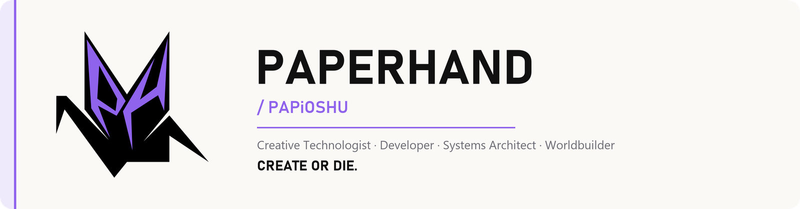

  

  <a href="#about">About</a> ·
  <a href="#selected-work">Selected Work</a> ·
  <a href="#projects">Projects</a> ·
  <a href="#creative-work">Creative Work</a> ·
  <a href="#development-workflow">Development Workflow</a> ·
  <a href="#capabilities">Capabilities</a> ·
  <a href="#connect">Connect</a>

## About

I'm **Paperhand**, also **PAPiOSHU**. I build software, games, creative tools, and the infrastructure behind them.

Music, film, worldbuilding, community, and code aren't separate hobbies for me. They feed each other: a beat needs a tool to manage it, a world needs an engine to run it, a collection needs a system to launch it, and a crew needs a home online. I work across all of it, end to end.

> **Building tools, worlds, and infrastructure for people who create.**

## Selected Work

| Project | What it is | Stack | Links |
|---|---|---|---|
| **Paperhand Beat Manager** | Desktop app for producers: catalog beats, auto-detect BPM and key, stamp producer tags on previews without touching masters, split stems, package buyer bundles. | Python · PySide6 · audio processing · Windows installer | [Repo](https://github.com/papioshu/paperhands-beat-tools) · [Releases](https://github.com/papioshu/paperhands-beat-tools/releases) |
| **FLY WING GENESIS: FLYLIST** | Allowlist registration for the FLY WING GENESIS collection: wallet sign-in, server-side eligibility checks, and an admin console with audit trail and CSV exports. No transactions; balances are only read. | TypeScript · React · wagmi/viem · Supabase Edge Functions · Postgres · Cloudflare Pages | [Repo](https://github.com/papioshu/flywing-flylist) · [Live](https://chasingclouds.xyz) |
| **OARA** | Original browser-first 3D action RPG: movement, combat, environments, and a full skating system with tricks, grinds, and scoring. | TypeScript · Vite · Three.js · Rapier physics | Private, in active development |
| **PapertrailOS** | Two apps under one name: a desktop command center for organizing projects and keeping systems in check, and a lead tracker that researches, grades, and follows up on leads with approval-gated outreach. | Desktop app · TypeScript | [Lead tracker repo](https://github.com/papioshu/papertrailOS) · Command center private |
| **Nimbus Generator** | Reusable generative collection engine. The core is collection-agnostic; each collection is a self-contained project. | Generative tooling · asset pipelines | Private, in development |
| **BOMBSQUAD / BMBSQD** | Creative collective: media, music, identity, merch, and the site that ties it together. | Web · commerce integrations | [bombtheworld.io](https://bombtheworld.io) |

## Projects

  
<strong>Explore the full project directory</strong>

 

**Software & Developer Tools**
- **PapertrailOS**: desktop command center for project organization and system management (*private*), plus a [lead tracker](https://github.com/papioshu/papertrailOS) for lead research, grading, and follow-up. *In development.*

**Games & Interactive Worlds**
- **OARA**: original 3D action RPG with movement, combat, and skating systems. *Private, active.*

**Web3 & Creator Infrastructure**
- **[FLYLIST](https://github.com/papioshu/flywing-flylist)**: wallet registration and eligibility workflow for FLY WING GENESIS. *Live at [chasingclouds.xyz](https://chasingclouds.xyz).*
- **Nimbus Generator**: generative collection engine and asset tooling. *Private.*
- **[MeshCrypt Chat](https://github.com/papioshu/meshcrypt-chat)**: encrypted, offline-first mesh messaging (Flutter). *Experimental.*

**Music & Creative Technology**
- **[Paperhand Beat Manager](https://github.com/papioshu/paperhands-beat-tools)**: beat catalog, producer tagging, stems, and packaging. *Released, v1.0.1.*

**Creative Media & Production**
- **BOMBSQUAD / BMBSQD**: media, music, identity, and merch for the crew. *Live at [bombtheworld.io](https://bombtheworld.io).*

## Creative Work

Code is one medium. The rest of the work:

- **Music production**: beats, and the tools I use to manage and sell them
- **Videography & photography**: event coverage, artist content, visual storytelling
- **Creative direction**: identity, look, and voice for projects and collaborators
- **Worldbuilding**: original settings and characters, and the systems that make them playable
- **Digital identity & interactive experiences**: collections, sites, and spaces people can step into
- **BOMBSQUAD**: collaborations across music, media, and streetwear
- **Independent creative communities**: building with and for people who make things

## Development Workflow

  
<strong>How I build</strong>

 

I direct the work; AI is tooling. I use **Claude Code** and **Codex** as development collaborators, often in separate lanes so their changes don't collide.

On my larger projects, continuity lives in four plain files:

| File | Purpose |
|---|---|
| `CONTINUITY LOG.md` | Short current handoff: where things stand right now |
| `TASKS.md` | Now / Next / Later / Blocked |
| `PROJECT LOG.md` | Append-only dated session log with commit hashes |
| `DECISIONS.md` | Numbered decisions, superseded but never deleted |

One master passdown, kept in a separate private workspace, indexes every project.

**Principles**
- Document decisions, not just code.
- Track progress so any session, human or agent, can pick up cold.
- Read the actual codebase before changing it.
- Test instead of assuming it works.
- Favor maintainable, exportable systems over lock-in.
- AI works under human direction, not the other way around.

## Capabilities

| Area | Where it shows up |
|---|---|
| **TypeScript / JavaScript · React** | FLYLIST, OARA, PapertrailOS |
| **Three.js / interactive 3D** | OARA (Three.js + Rapier physics) |
| **APIs & backend** | Supabase Edge Functions, Postgres, wallet sign-in (SIWE) |
| **Cloudflare · Supabase** | FLYLIST hosting and backend |
| **Web3 integrations** | wagmi/viem, on-chain reads, collection tooling |
| **Python desktop apps** | Paperhand Beat Manager (PySide6, packaged installer) |
| **Media & audio technology** | Producer tagging, stem splitting, BPM/key detection |
| **AI-assisted development** | Claude Code + Codex with documented continuity |
| **Automation & tooling** | Build scripts, asset pipelines, continuity checks |

## Connect

- **GitHub**: [github.com/papioshu](https://github.com/papioshu)
- **BOMBSQUAD**: [bombtheworld.io](https://bombtheworld.io)
- **FLY WING GENESIS**: [chasingclouds.xyz](https://chasingclouds.xyz)

  
   
  <strong>CREATE OR DIE.</strong>

